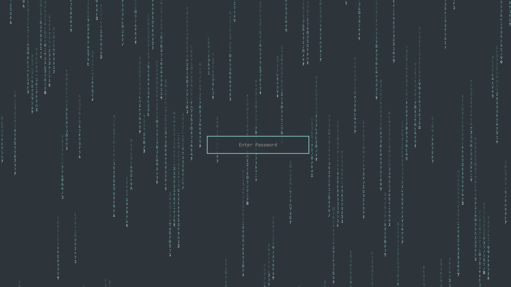

# Matrix Lock

Draws the [Matrix Rain](https://github.com/nzkritik/omarchy-matrix-rain) effect
on the [Omarchy](https://omarchy.org/) lock screen, and tells you when an
Omarchy update has left it out of date.



Preview it without locking yourself out with `omarchy-shell lock preview`.

The rain replaces the blurred wallpaper on every lock, in your theme's accent
colour, whatever your desktop background is. It pairs well with
[Matrix Rain](https://github.com/nzkritik/omarchy-matrix-rain) on the desktop,
but does not need it.

## Settings

Two timings, both counted from the last key press or mouse movement on the
lock screen. The defaults behave exactly like stock Omarchy.

| Setting | Default | What it does |
| --- | --- | --- |
| `hide-fields` | off | Fade the password field out after this long, leaving only the rain. The first key press brings it back and is not typed into the field. |
| `display-off` | 5s | Turn the display off after this long. `off` keeps it on until you unlock. |

```bash
omarchy-matrix-lock set hide-fields 5s     # a rain-only screensaver after 5 seconds
omarchy-matrix-lock set display-off 1h     # and the display off after an hour
omarchy restart shell
```

Times are seconds, or `30s`, `2m`, `1h`, or `off`, up to 24 hours. They are
stored on this plugin's entry in `~/.config/omarchy/shell.json`, so they travel
with the rest of your shell settings:

```json
{ "id": "nzkritik.matrix-lock", "hideFieldsAfter": 5, "displayOffAfter": 3600 }
```

If you edit that by hand, run `omarchy-matrix-lock sync` and restart the shell.
Omarchy does not pass a service plugin its `shell.json` entry, and the lock
screen should not read your files while it runs anyway, so the values are
written into the generated lock screen instead. `omarchy-matrix-lock status`
says when the two disagree.

`omarchy-shell lock preview` runs the `hide-fields` countdown too, so you can
see it without locking.

## Install

```bash
omarchy plugin add https://github.com/nzkritik/omarchy-matrix-lock --enable
ln -s ~/.config/omarchy/plugins/nzkritik.matrix-lock/bin/omarchy-matrix-lock ~/.local/bin/
omarchy-matrix-lock install
omarchy restart shell
```

Adding the plugin changes nothing by itself: your lock screen is only cloned
and patched when you run `install`. If you add it and skip that step, it tells
you once, in a notification with the exact command, and never again.

```bash
omarchy-matrix-lock status      # what is installed, and the settings in effect
omarchy-matrix-lock set …       # change a setting (see above)
omarchy-matrix-lock sync        # after an Omarchy update, or after updating this plugin
omarchy-matrix-lock uninstall   # put the stock lock screen back
omarchy-matrix-lock check       # quiet; exit 0 current, 3 stale, 1 not installed
```

**Upgrading from 1.2 or earlier:** run `omarchy-matrix-lock sync` after
updating (the plugin reminds you). From 1.3 the rain shows on every lock, not
only while Matrix Rain is your wallpaper, and the clone's `Service.qml` is
generated too, to carry the settings.

## GPU rendering, with a CPU fallback

The rain is drawn by one fragment shader. Every column is a function of time
worked out on the GPU, over a texture of the glyphs rendered once from ordinary
text, so the CPU only advances a clock, 30 times a second.

| Renderer | File | CPU at 1920x1080 | Used when |
| --- | --- | --- | --- |
| GPU | `MatrixRainGpu.qml`, `rain.frag` | about 2% of a core | the scene graph is hardware accelerated (normally) |
| CPU | `MatrixRainCpu.qml` | about 25% of a core | a software scene graph, or the shader fails to load |

`MatrixRain.qml` picks between them by itself. Both look the same, and a fall
back is logged once to the journal as
`matrix rain: shader unavailable, falling back to the CPU renderer`.

Qt 6 only loads precompiled shaders, so `rain.frag.qsb` (`rain.frag` built by
Qt's `qsb`) is committed alongside its source. `tools/build-shaders.sh` rebuilds
it byte for byte, so anyone can check the binary matches the source.

The renderer is self-contained: the `MatrixRain*.qml` files and the shader ship
here and are copied into the clone, rather than loaded from the Matrix Rain
plugin, so updating or removing that plugin can never break your lock screen.

## What it does to your system

Omarchy's lock screen is a `WlSessionLock` surface, and a session lock covers
every layer-shell surface on the output — so a wallpaper overlay cannot show
through it, and the rain has to be drawn inside the lock screen's own QML. The
supported way to change a built-in plugin is `omarchy plugin clone`, so
`install` clones `omarchy.lock` to `<user>.lock` and patches the clone.

`LockView.qml` and `Service.qml` are regenerated from the lock screen **you
have installed** each time you run `install`, `sync` or `set`, rather than
shipping frozen copies, and every patch anchor must match exactly once or the
edit is refused rather than half-applied. Both files are generated before
either is written, so a refusal leaves your current lock screen as it was.

`Service.qml` holds the password and fingerprint PAM flow, and none of that is
touched: the patch only replaces the fixed 5-second display-off delay with the
`display-off` setting, and adds the `hide-fields` countdown beside it. A
`Service.qml` you have edited yourself is refused, not overwritten.

Two things to know before you install it:

- **The clone stops tracking upstream.** Your lock screen will not pick up fixes
  to `omarchy.lock`, security ones included, until you run `sync`. This is why
  the plugin ships a service at all: it records which stock lock screen the
  clone was generated from, and notifies you on the next shell start after it
  changes. That is the notification you get after `omarchy update`.
- `uninstall` removes the clone outright only when nothing of yours would go
  with it — otherwise it restores the stock files and leaves your clone in place.

## Handling untrusted paths

The output of this script becomes a lock screen, so the paths it touches get
more care than a wallpaper would need.

- The stock lock files are resolved from a fixed `/usr/share/omarchy`, never
  from `$OMARCHY_PATH` — the environment must not be able to redirect the files
  whose contents become your lock screen.
- The settings read from `shell.json` must be whole numbers from 0 to 86400;
  anything else falls back to the default, and they are written into the lock
  screen as integer literals, never as text. A `shell.json` symlink (from a
  dotfile manager) is resolved once to a regular file, and read and written
  there under the rules below.
- Every tool is resolved from `/usr/share/omarchy/bin` and `/usr/bin` only.
  The script pins `PATH` to those two root-owned directories, and the plugin
  starts it with that `PATH`, by full path, and without `BASH_ENV`, so nothing
  earlier on an inherited `PATH` can stand in for a tool.
- The clone id comes from `id -un`, not `$USER`, and is validated as a single
  safe path component before it is used as a directory name.
- Every read of a user-writable path goes through one bounded, no-follow,
  non-blocking helper, so a symlink is refused, a planted FIFO returns instead
  of wedging the process, and a swollen file cannot be pulled in whole.
- Every write is staged in the destination directory, `fsync`ed, and committed
  with an atomic rename, after refusing any destination that is a symlink or
  not a regular file.

## Uninstall

```bash
omarchy-matrix-lock uninstall
omarchy plugin remove nzkritik.matrix-lock --yes
rm -rf ~/.local/state/omarchy-matrix-lock
rm -f ~/.local/bin/omarchy-matrix-lock
```

Take the lock screen off *first*, while this plugin is still around to do it.
Removing the plugin without that leaves the clone behind with its own copy of
`MatrixRain.qml` — that still works, but `omarchy plugin remove <user>.lock` is
then the way to undo it.

## Licence

MIT
